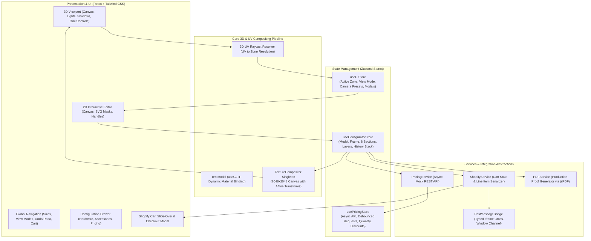

# Interactive 3D Canopy Tent Configurator
**Technical Assessment for Vertical 3D Tech**  
*Benchmark Reference:* [MVP Visuals 10x10 Custom Canopy Tent](https://mvpvisuals.com/products/10x10-custom-canopy-tent)

---

## 🌟 1. Overview & Assessment Alignment

This repository contains a production-grade, modular **Interactive 3D Product Configurator** for custom commercial canopy tents. Built using **React 18, TypeScript, Three.js, React Three Fiber (R3F), Drei, Zustand, and Tailwind CSS**, the application mirrors the end-to-end purchasing and customization workflow of industry benchmark custom tent suppliers.

### Key Capabilities
- **8 Independent Printable Zones:** 4 Peaks (Front, Back, Left, Right) and 4 Valances (Front, Back, Left, Right) customizable with text, uploaded logos, and fabric colors without cross-zone bleed or texture deformation.
- **Real-Time 2D–3D Synchronization:** Changes made in the 2D interactive editor (dragging, scaling, rotating, color picking) composite instantaneously onto the 3D model at 60 FPS using an offscreen affine $2048 \times 2048$ CanvasTexture pipeline.
- **3D Raycast Face Picking:** Clicking any canopy face directly in the 3D viewport selects that zone in the 2D editor.
- **Dynamic GLB Model Switching:** Supports the supplied 3D tent models (`Tent_5_5.glb`, `Tent 6.5_6.5.glb`, `Tent_8_8.glb`) with automatic camera reframing and preserved customizations.
- **Decoupled Dynamic Pricing Engine:** Asynchronous service abstraction calculating base costs, frame upgrades, print setup fees, accessories, quantity scaling, volume discounts, and promo codes.
- **Shopify Storefront Mock Integration:** Full Cart Drawer with quantity steppers, checkout simulation, and formatted line-item properties (`_configId`, `_configJSON`, `Size`, `Frame Finish`, `Customized Zones`, `Accessories`, thumbnail).
- **Client-Side Production PDF Generator:** Exports a high-resolution production sheet featuring order specs, itemized BOM, 3D perspective snapshot, and flat 2D unfolded print proof.
- **Iframe Embedding & Two-Way `postMessage` Communication:** Responsive embeddability with bidirectional parent-host messaging, demonstrated via `/iframe-demo.html`.

---

## 🏗️ 2. Architectural Design



### Architectural Decisions
1. **Decoupled Engine & UI:** The Three.js canvas texture compositor operates as a pure TypeScript singleton (`TextureCompositor.ts`), decoupled from React rendering lifecycles to prevent unnecessary React re-renders during high-frequency mouse drags.
2. **Normalized State Architecture:** Zustand holds the complete canonical configuration in a JSON-serializable tree (`ProductConfig`). All 8 printable zones have dedicated layer arrays, enabling deterministic serialization and undo/redo time travel.
3. **RequestAnimationFrame Throttling:** Rapid layer dragging in 2D is throttled via `requestAnimationFrame` before triggering canvas re-compositing and WebGL texture upload (`texture.needsUpdate = true`).

---

## 🔍 3. 3D Model Analysis & UV Mapping Geometry

The supplied GLB models (`Tent_5_5.glb`, `Tent 6.5_6.5.glb`, `Tent_8_8.glb`) in `public/models/` were geometrically analyzed to ensure faithful mapping:

### UV Star-Cross Mapping
The canopy mesh material (`fabric_Mat`) is unrolled as a symmetric 4-way cross on a $2048 \times 2048$ master canvas. Each zone maps to distinct bounding coordinates:
- **Front Peak (Facing +Z):** Center `(1024, 1522)`, upright rotation $0^\circ$, bounding box $U \in [0.25, 0.75], V \in [0.57, 0.91]$
- **Front Valance:** Center `(1024, 1923)`, upright rotation $0^\circ$, bounding box $U \in [0.25, 0.75], V \in [0.91, 0.98]$
- **Back Peak (Facing -Z):** Center `(1024, 526)`, rotation $180^\circ$, bounding box $U \in [0.25, 0.75], V \in [0.09, 0.43]$
- **Back Valance:** Center `(1024, 125)`, rotation $180^\circ$, bounding box $U \in [0.25, 0.75], V \in [0.02, 0.09]$
- **Left Peak (Facing -X):** Center `(526, 1024)`, rotation $+90^\circ$ (clockwise), bounding box $U \in [0.09, 0.43], V \in [0.25, 0.75]$
- **Left Valance:** Center `(125, 1024)`, rotation $+90^\circ$ (clockwise), bounding box $U \in [0.02, 0.09], V \in [0.25, 0.75]$
- **Right Peak (Facing +X):** Center `(1522, 1024)`, rotation $-90^\circ$ (counter-clockwise), bounding box $U \in [0.57, 0.91], V \in [0.25, 0.75]$
- **Right Valance:** Center `(1923, 1024)`, rotation $-90^\circ$ (counter-clockwise), bounding box $U \in [0.91, 0.98], V \in [0.25, 0.75]$

### Model Hierarchy & Primitive Inversion Handling
- In `Tent_5_5.glb` and `Tent 6.5_6.5.glb`, mesh primitive index `0` is `fabric_Mat` and index `1` is `Inner_fabric`.
- In `Tent_8_8.glb`, mesh primitive index `0` is `Inner_fabric` and index `1` is `fabric_Mat`.
- **Solution:** `TentModel.tsx` dynamically inspects `mat.name === 'fabric_Mat'` to bind materials rather than assuming hardcoded primitive indices. Hardware (`Metal_mat`) and interior fabric (`Inner_fabric`) are isolated from the dynamic canvas texture.

---

## 💻 4. Installation & Setup

### Prerequisites
- **Node.js:** v18.0.0 or higher (v20+ recommended)
- **npm:** v9.0.0 or higher

### Step-by-Step Installation

1. **Clone or navigate to the repository:**
   ```bash
   git clone https://github.com/AyushVishwakarma-CodeHub/interactive-3d-product-configurator.git
   cd interactive-3d-product-configurator
   ```

2. **Install project dependencies:**
   ```bash
   npm install
   ```

3. **Configure 3D Models & Assets:**
   Place your 3D tent GLB models into `public/models/`:
   - `public/models/Tent_5_5.glb` (5x5 ft compact canopy)
   - `public/models/Tent 6.5_6.5.glb` (6.5x6.5 ft mid-size canopy)
   - `public/models/Tent_8_8.glb` (8x8 ft full event canopy)
   > *Note: Proprietary company-supplied 3D assets are excluded from this public repository under intellectual property guidelines. A `.gitkeep` file preserves the directory structure.*

4. **Configure environment variables:**
   ```bash
   cp .env.example .env
   ```

5. **Start the local development server:**
   ```bash
   npm run dev
   ```
   Open [http://localhost:3000](http://localhost:3000) in your browser.

6. **Build for production:**
   ```bash
   npm run build
   ```

7. **Preview the production build:**
   ```bash
   npm run preview
   ```

---

## 🌐 5. Environment Variables

The project includes an [`.env.example`](file:///.env.example) template:

| Variable | Type | Default | Description |
|---|---|---|---|
| `VITE_APP_TITLE` | `string` | `"Vertical 3D Tech — Canopy Configurator"` | Browser tab title and top header branding |
| `VITE_SHOPIFY_STORE_DOMAIN` | `string` | `"demo-canopy-store.myshopify.com"` | Shopify store domain for checkout links |
| `VITE_SHOPIFY_STOREFRONT_TOKEN`| `string` | `""` | Optional Storefront API token for live Shopify cart synchronization |
| `VITE_PRICING_API_ENDPOINT` | `string` | `""` | Optional external REST API endpoint. When omitted, the built-in asynchronous service simulation is used |
| `VITE_ENABLE_POSTMESSAGE_LOGS` | `boolean` | `"true"` | Enables verbose console logging for iframe messages |

---

## 📡 6. API & Service Documentation

### `PricingService` (`src/services/pricingService.ts`)
Decoupled singleton service implementing asynchronous pricing calculations:
- `calculatePrice(config, discountCode?, quantity?, signal?): Promise<PricingBreakdown>`
  - Simulates 120ms network latency with `AbortSignal` cancellation support.
  - Base Pricing: 5x5 ($499), 6.5x6.5 ($649), 8x8 ($849).
  - Frame Surcharges: Silver ($0), Stealth Black (+$45), Gloss White (+$35).
  - Dye-Sub Printing: 1st location complimentary ($0), additional locations +$40/ea, artwork pre-flight +$25.
  - Accessories: Roller bag ($65), Sandbags 4-pk ($40), Ground stakes ($25), Flag mounts ($35).
  - Wholesale Volume Tiers: $\ge 3$ units = 5% off; $\ge 5$ units = 10% off.
  - Promotional Codes: `VERTICAL10` or `MVP10` yields 10% discount.

### `ShopifyService` (`src/services/shopifyService.ts`)
Client-side adapter managing a mock Shopify cart conforming to the Shopify Storefront API:
- `getCart(): ShopifyCartState`
- `addToCart(config, pricing, previewThumbnail, quantity): ShopifyCartLineItem`
  - Attaches formatted Shopify line-item properties (`Size`, `Frame Finish`, `Base Canopy Color`, `Customized Zones`, `Accessories`, `_configJSON`).
  - Emits `ADD_TO_SHOPIFY_CART` to the host parent window when inside an iframe.
- `updateQuantity(itemId, quantity)`
- `removeItem(itemId)`
- `clearCart()`

### `PostMessageBridge` (`src/services/postMessageBridge.ts`)
Manages bidirectional cross-window communication for iframe embedding:
- Outgoing events (Configurator ➔ Host):
  - `CONFIGURATOR_READY`: Dispatched when the 3D canvas mounts.
  - `CONFIGURATOR_UPDATED`: Dispatched whenever configuration or pricing changes.
  - `ADD_TO_SHOPIFY_CART`: Dispatched with full line-item payload when added to cart.
- Incoming events (Host ➔ Configurator):
  - `SET_SIZE`: Changes tent size (`'5x5'`, `'6.5x6.5'`, `'8x8'`).
  - `SET_FRAME_FINISH`: Changes frame finish (`'silver'`, `'black'`, `'white'`).
  - `SET_GLOBAL_COLOR`: Sets canopy color hex.
  - `SET_CONFIG`: Loads a complete `ProductConfig` JSON object.

### `PDFService` (`src/services/pdfService.ts`)
Generates high-resolution multi-section production specification PDFs:
- `generateProductionPDF(config, pricing, snapshots, options): Promise<Blob>`
  - Vector order manifest, client information, fire/safety ratings.
  - Side-by-side 3D perspective rendering and 2D unfolded UV print template.
  - Customized zones listing with exact text and logo counts.
  - Itemized commercial bill of materials, subtotal, discounts, tax, and final total.
- `downloadPDF(blob, filename)`

---

## 🖼️ 7. Iframe Embedding Test Harness

To test the configurator embedded within an external host website:
1. Ensure the development server is running on `http://localhost:3000`.
2. Open [http://localhost:3000/iframe-demo.html](http://localhost:3000/iframe-demo.html).
3. The demo page demonstrates:
   - Configurator running inside a sandboxed `<iframe>`.
   - Real-time telemetry log displaying incoming `CONFIGURATOR_READY` and `CONFIGURATOR_UPDATED` events.
   - Synchronized price and status tracking on the parent website.
   - Host action buttons (`Set Size: 8x8`, `Finish: Stealth Black`, `Color: Royal Blue`) dispatching commands into the iframe.
   - Shopify cart listener capturing the line-item payload upon checkout.

---

## ⚠️ 8. Known Limitations & Technical Notes

1. **UV Mapping Star Cross Geometry:**
   The supplied 3D GLB models use a single continuous mesh for the outer canopy unrolled into a 4-way cross. The application mathematically maps upright 2D design panels to their corresponding UV quadrants. However, seamless continuous artwork wrapping around the diagonal peak seams is governed by the underlying model's UV seam boundaries.
2. **Shopify Integration Scope:**
   This implementation is a high-fidelity **Shopify Mock Storefront Integration**. It accurately creates line items with Shopify-compliant attributes (`line_item_properties`), manages an interactive cart drawer, and executes simulated checkouts. It does not perform live network calls to a production Shopify Storefront API endpoint unless a private Storefront Access Token is supplied.
3. **Headless WebGL Rendering:**
   When running headless browser automated tests in environments without hardware GPU acceleration (e.g., CI/CD containers or software SwiftShader), compiling the PBR tone-mapping shaders and environment maps may require 4–6 seconds on initial scene mount.
4. **Supplied 3D Models:**
   The original models in `Tent_glb (3)/` remain completely untouched. Models are served from `public/models/`.

---

## 🚢 9. Deployment Instructions

### Option A: Vercel / Netlify (Recommended)
1. Push this repository to GitHub or GitLab.
2. Import the project in Vercel or Netlify.
3. Configure build settings:
   - **Build Command:** `npm run build`
   - **Output Directory:** `dist`
4. Deploy.

### Option B: Docker / Nginx
Create a `Dockerfile`:
```dockerfile
FROM node:20-alpine AS builder
WORKDIR /app
COPY package*.json ./
RUN npm ci
COPY . .
RUN npm run build

FROM nginx:alpine
COPY --from=builder /app/dist /usr/share/nginx/html
COPY nginx.conf /etc/nginx/conf.d/default.conf
EXPOSE 80
CMD ["nginx", "-g", "daemon off;"]
```

### Option C: AWS S3 + CloudFront
1. Run `npm run build`.
2. Sync the `dist/` directory to your S3 bucket:
   ```bash
   aws s3 sync dist/ s3://your-canopy-configurator-bucket --delete
   ```
3. Invalidate the CloudFront distribution cache:
   ```bash
   aws cloudfront create-invalidation --distribution-id YOUR_DIST_ID --paths "/*"
   ```
